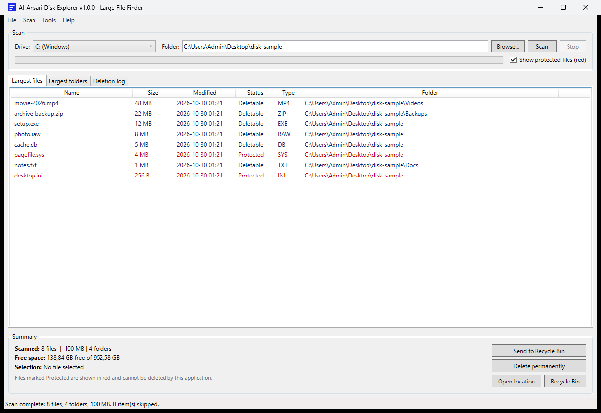
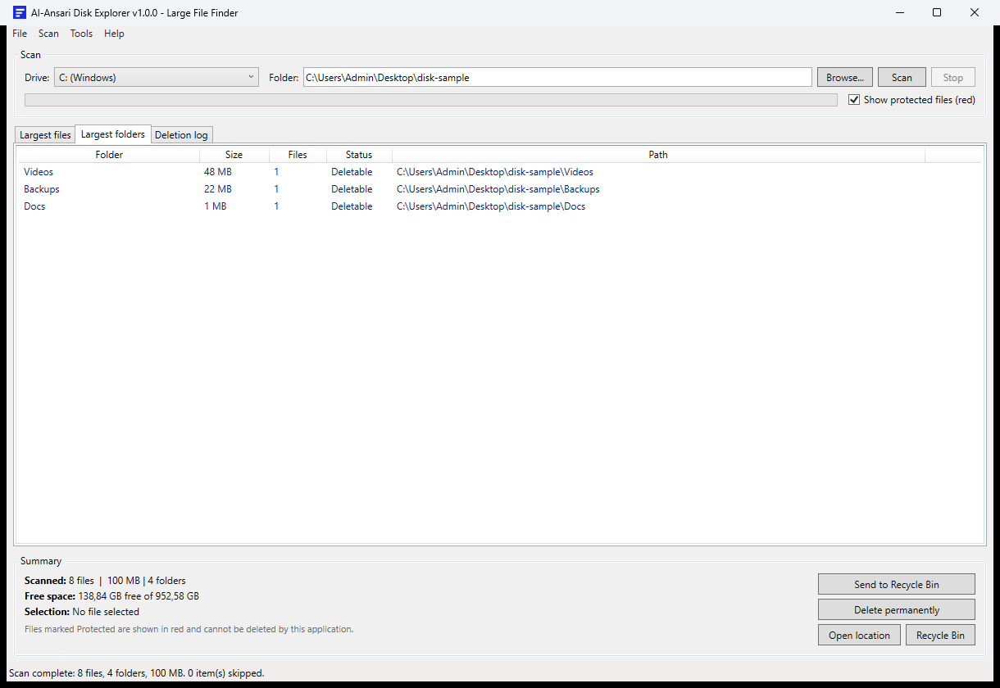
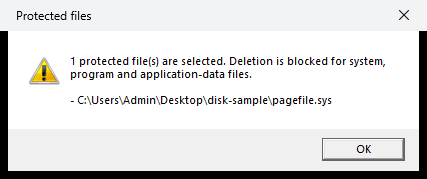

<p align="center">
  
</p>

<h1 align="center">AL-ANSARI SOFTWARES</h1>
<h3 align="center">Al-Ansari Disk Explorer</h3>

<p align="center">
  A fast, classic Windows tool that finds the largest files and folders and deletes them safely.
</p>

<p align="center">
  <a href="https://github.com/urbanyl/al-ansari-disk-explorer/releases/latest"></a>
  <a href="https://github.com/urbanyl/al-ansari-disk-explorer/releases"></a>
  
  
  
  
  <a href="https://github.com/urbanyl/al-ansari-disk-explorer/stargazers"></a>
</p>

---

## Table of contents

- [Overview](#overview)
- [Screenshots](#screenshots)
- [Features](#features)
- [Safety rules](#safety-rules)
- [Requirements](#requirements)
- [Installation](#installation)
- [Usage](#usage)
- [Build from source](#build-from-source)
- [How it works](#how-it-works)
- [Data and journal](#data-and-journal)
- [Project structure](#project-structure)
- [Disclaimer](#disclaimer)
- [License](#license)

---

## Overview

**Al-Ansari Disk Explorer** scans any drive or folder and lists the largest files and folders as they are found. Results are streamed during the scan, so large files appear immediately instead of waiting for the end.

Deletion is protected by design: system, program and application-data files are shown in **red** and cannot be deleted by the application. Deletions go to the Recycle Bin by default; permanent deletion is available behind a stronger warning. Every deletion is written to a local journal.

It runs as a normal user, needs no administrator rights, installs nothing, and makes no network calls.

## Screenshots

| Largest files | Largest folders |
| --- | --- |
|  |  |

Protected files are shown in red, and deletion is blocked:



## Features

- **Fast native scanner** using `FindFirstFileExW` with large-fetch mode, one pass per directory.
- **Live streaming**: top files and folders appear while the scan is running, with counts and progress.
- **Top 1000 largest files** and **top 300 largest folders** with aggregated sizes and file counts.
- **Folder tree aggregation** computed from the scan, not by repeated directory walks.
- **Protected-file engine** with clear reasons (Windows, Program Files, ProgramData, AppData, system files, system attributes).
- **Deletion blocked** when any protected file is selected.
- **Recycle Bin by default**; optional permanent deletion with a confirmation that defaults to No.
- **Skip protected items completely** with the "Show protected files" option: unchecked, protected files and folders are not scanned at all.
- Multiple selection, selection size, free-space display, open location, open Recycle Bin.
- **Deletion journal** stored locally.
- Classic Win32-style English interface, no admin, no telemetry.

## Safety rules

Files and folders are treated as protected when they are:

- inside `Windows`, `Windows.old`, `Program Files`, `Program Files (x86)`, `ProgramData`, `$Recycle.Bin`, `System Volume Information`, `Recovery`, `Boot`, `EFI` or `PerfLogs`;
- inside any `AppData` folder (application data);
- named `pagefile.sys`, `hiberfil.sys`, `swapfile.sys`, `bootmgr`, `BOOTNXT`, `BCD`, `ntldr`, `ntuser.dat`, `ntuser.ini`, `desktop.ini`, `boot.ini`, `bootfont.bin` or dump-stack logs;
- a `.sys` file at the root of a drive;
- marked with the Windows **System** attribute.

Deletion is refused for the whole selection if at least one protected file is included. The check is performed again by the deletion service, not only by the interface.

## Requirements

- Windows 10 or Windows 11 (x64).
- A normal user account (no administrator rights required).
- For the source build: .NET 10 SDK with the Windows Desktop workload.
- The release package is self-contained; no .NET runtime installation is needed.

## Installation

1. Open the [latest release](https://github.com/urbanyl/al-ansari-disk-explorer/releases/latest).
2. Download `Al-Ansari-Disk-Explorer-1.0.0-win-x64.zip`.
3. Extract the archive anywhere.
4. Run `AlAnsariDiskExplorer.exe`.

## Usage

1. Pick a drive or browse to a folder.
2. Click **Scan**. Results appear progressively; the status bar shows files, size and current folder.
3. Keep **Show protected files** checked to see protected items in red (and have them blocked on delete).
   Uncheck it to skip protected files and folders entirely and scan only the rest.
4. Select files in **Largest files** (multi-selection is supported).
5. Click **Send to Recycle Bin** (recommended) or **Delete permanently**.
6. Use **Open location** or double-click a file to reveal it in Explorer.
7. Review past deletions in **Deletion log**.

## Build from source

```powershell
git clone https://github.com/urbanyl/al-ansari-disk-explorer.git
cd al-ansari-disk-explorer
dotnet build -c Release
dotnet run --project AlAnsariDiskExplorer
```

Publish a self-contained single file:

```powershell
dotnet publish AlAnsariDiskExplorer/AlAnsariDiskExplorer.csproj `
  -c Release -r win-x64 --self-contained true `
  -p:PublishSingleFile=true `
  -p:IncludeNativeLibrariesForSelfExtract=true `
  -o artifacts/win-x64
```

## How it works

| Area | Mechanism |
| --- | --- |
| File enumeration | `FindFirstFileExW` with `FindExInfoBasic` and `FIND_FIRST_EX_LARGE_FETCH`, one handle per directory |
| Folder sizes | In-memory directory tree, subtree totals computed on demand |
| Large files | Bounded min-heap of the 1000 largest files |
| Large folders | Bounded min-heap of the 300 largest folders |
| Protection rules | Path rules plus Windows file attributes (`System`) |
| Recycle Bin | `SHFileOperation` with `FOF_ALLOWUNDO` |
| Permanent deletion | `File.Delete` with per-file error reporting |
| Journal | `%LOCALAPPDATA%\Al-Ansari\DiskExplorer\deletions.log` |

Reparse points (junctions, symbolic links) are not followed, which avoids loops and double counting.

## Data and journal

```
%LOCALAPPDATA%\Al-Ansari\DiskExplorer\
└── deletions.log      every deleted file, mode (RECYCLE/PERMANENT) and size
```

No other data is stored. No network connection, no telemetry, no service.

## Project structure

```
Al-Ansari-Disk-Explorer/
├── AlAnsariDiskExplorer/
│   ├── Infrastructure/     commands and observable objects
│   ├── Models/             file, folder, drive entries, size formatting
│   ├── Services/           scanner, protection rules, safe deletion, journal
│   ├── ViewModels/         main view model
│   ├── Assets/             application icon
│   └── MainWindow.*        classic Win32-style UI
├── docs/
│   ├── logo.png / logo.svg
│   └── screenshots/
├── LICENSE
└── README.md
```

## Disclaimer

This tool deletes files at your request. Deletions sent to the Recycle Bin can usually be restored; permanent deletions cannot. Protected-file rules reduce risk but do not replace your own judgement. Use it on devices you own or are authorized to manage. The authors are not responsible for data loss caused by deliberate permanent deletions.

## License

[MIT](LICENSE) © 2026 Al-Ansari Softwares
